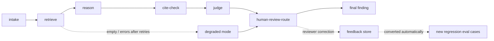

# Architecture — Agentic Claims Audit

## Nodes

| Node | Responsibility |
|---|---|
| intake | Validate the claim, initialise state |
| retrieve | One query per billed code against the hybrid index; retry with backoff; context budget enforcement |
| reason | Deterministic stub reasoner (v0.1) over claim + history signals: duplicate, upcoding, missing documentation, medical necessity, bundling. A real LLM reasoner plugs in behind the gateway without changing the graph |
| cite-check | Drop any finding whose citations do not support it |
| judge | LLM-as-judge interface; deterministic local judge offline, OpenAI-compatible judge client for a live endpoint |
| human-review-route | Medical-necessity findings, low judge scores, and degraded runs go to `human_review`; the rest `auto_finalize` |
| final | Emit structured result + trace JSON |

## Context strategy

- Budget: 1,200 tokens of retrieved context per claim (`CONTEXT_TOKEN_BUDGET`), counted by whitespace tokenisation in v0.1.
- One focused query per billed procedure code beats one giant query: retrieval stays code-specific and the metadata pre-filter can apply.
- Retrieved documents are added in rank order until the budget is full; overflow is dropped, never silently truncated mid-document.
- Tool surface is deliberately small: `search` is the agent's only external tool in v0.1, which keeps traces auditable.

## Retrieval

Chunking (`aca/chunking.py`: fixed windows with overlap, plus sentence-aware mode) → BM25 (pure Python) + TF-IDF vectors behind `/v1/embeddings` (pluggable real embedder) → Reciprocal Rank Fusion (k=60) → metadata pre-filter on procedure code → cross-encoder-style reranker behind `Reranker.score_pair` (lightweight local scorer in v0.1).

## Failure recovery

Retrieval errors retry with exponential backoff (3 attempts). Persistent failure or an empty result set sets `degraded=true`: rules still run, findings are kept, and the run is routed to human review instead of auto-finalising. Every run emits a trace: node names, timings (fallback runtime), retrieved document IDs (in state), route, and graph backend.

## Gateway

Embedded OpenAI-compatible gateway (`aca/gateway.py`): `/v1/chat/completions` (stub backend offline), `/v1/models`, `/v1/embeddings` (384-dim hashing embedder). Product features call the gateway, so swapping the stub for a real upstream changes no product code.
